<!--
  ██████╗  █████╗ ██╗   ██╗ █████╗ ██████╗  █████╗
  Profile README → repo:  minelatech/minelatech
  Author:  Mamadou Lamine Konaté  ·  MINELATECH
-->

<div align="center">

<!-- Branded, self-contained animated banner (lives in the repo → always renders) -->


<br/>

<a href="https://readme-typing-svg.demolab.com">
  
</a>

<p>
  <a href="https://minelatech.fr"></a>
  <a href="https://www.linkedin.com/in/mamadou-lamine-konate"></a>
  <a href="mailto:contact@minelatech.fr"></a>
  
</p>

<p>
  
  
  
</p>

</div>

---

### 🧠 About me

```yaml
name:        "Mamadou Lamine Konaté"
role:        "AI & Big Data Engineer · Full-Stack Developer"
company:     "MINELATECH — founder & lead AI engineer"
current:     "Director of Digital & Commercial Strategy @ Security Alliance Privée"
focus:       ["LLM applications", "RAG systems", "autonomous agents", "data pipelines"]
philosophy:  "Every system I ship is built to create real, measurable value."
motto:       "Real solutions. For real people."
```

I'm an engineer who sits at the crossroads of **AI, full-stack development and data**. Through
**[MINELATECH](https://minelatech.fr)** I help businesses replace manual, WhatsApp-driven
processes with real products — from **digital staffing platforms** and **field-ops mobile apps**
to **multi-agent AI systems** and **enterprise RAG** engines.

What sets me apart is simple: **I understand the code *and* the business.** I don't ship demos —
I ship systems that go to production and stay there.

- 🔭 Building autonomous-agent & RAG platforms at **MINELATECH**
- 🚀 **12+ projects delivered** · **98% client satisfaction**
- 🌱 Currently going deeper on **LangGraph orchestration**, **vector search** and **MLOps**
- 💬 Ask me about **LLMs, RAG, agents, FastAPI, data engineering** — or turning an idea into a shipped product
- ⚡ Fun fact: I started in **pure mathematics** before falling in love with building things

---

### 🛠️ Tech Stack

**Languages**


**AI / LLM / Agents**


**Backend & Frontend**


**Data & Streaming**


**Infra, Cloud & Storage**


---

### 📌 Featured Projects

**🧪 Open-source** — full, runnable code (each runs offline out of the box):

| Project | What it does | Stack | |
|---|---|---|:--:|
| **[ai-agents-framework](https://github.com/minelatech/ai-agents-framework)** | Autonomous multi-agent orchestration — a central planner delegating to specialized agents | `LangGraph` · `GPT-4o` · `FastAPI` | [code →](https://github.com/minelatech/ai-agents-framework) |
| **[enterprise-rag](https://github.com/minelatech/enterprise-rag)** | Enterprise Q&A over internal docs — hybrid search (semantic + BM25), streaming API, citations | `LangChain` · `ChromaDB` · `FastAPI` | [code →](https://github.com/minelatech/enterprise-rag) |
| **[realtime-etl](https://github.com/minelatech/realtime-etl)** | High-volume streaming pipeline — ingest, clean & aggregate events in flight | `Kafka` · `PySpark` · `Airflow` | [code →](https://github.com/minelatech/realtime-etl) |

**🚀 Client work in production** — shipped for real businesses (source private):

| Project | What it does | Stack | |
|---|---|---|:--:|
| **Quick Extra Platform** | Digital staffing agency — replaced a 100% manual WhatsApp process with mission management, candidate tracking & a client dashboard | `React` · `FastAPI` · `PostgreSQL` · `Stripe` | [case study →](https://minelatech.fr) |
| **SecurityTrack (SAP Terrain)** | Field-ops app for security teams — planning, QR check-in, real-time incident log & PDF reports | `Flutter` · `FastAPI` · `Firebase` | [case study →](https://minelatech.fr) |
| **Falilou Ordering** | Restaurant online ordering — menu, cart & Stripe payments | `React` · `Node.js` · `Stripe` | [case study →](https://minelatech.fr) |

**🔭 In progress** — building now, more soon:

- **Sama Docteur** — digital health / telemedicine platform `🚧 WIP`
- **Athlio** — fitness & training app `🚧 WIP`

---

### 📊 GitHub Stats

<div align="center">


<!-- Contribution snake — generated by .github/workflows/snake.yml -->


</div>

---

### 🎓 Education & Certifications

**Education**

- 🎓 **Master's in AI & Big Data Engineering** — ESGI (École Supérieure du Génie Informatique)
- 🎓 **AI & Marketing** — IA School
- 🎓 **B.Sc. Mathematics** — Université Paris Diderot

**Certifications**


**In progress · 2026 roadmap**  <sub>(move any you already hold up to the list above)</sub>


---

### 🤝 What I can do for you

> Through **MINELATECH**, I turn ideas and manual processes into shipped software.

- 🤖 **AI Automation** — autonomous agents, chatbots, RAG & LLMs applied to your business
- 🌐 **Full-Stack Products** — web & mobile apps built to go to production
- 📊 **Data Engineering** — real-time ETL, analytics dashboards, massive-flow processing
- 🎨 **Design & Branding** — visual identity and communication assets

<div align="center">

**Let's build something real.** → [minelatech.fr](https://minelatech.fr) · [LinkedIn](https://www.linkedin.com/in/mamadou-lamine-konate)

<sub>⭐ From <a href="https://github.com/minelatech">minelatech</a> — real solutions, for real people.</sub>

</div>
